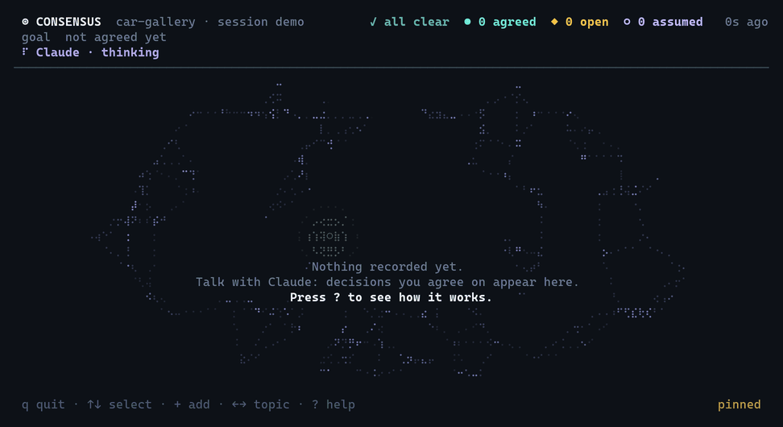

# Consensus

A live record of what you and your AI coding agent agreed, for **Claude Code** and **Codex**.

AI agents fill gaps with guesses and build on them, so you only find out what they assumed when the result is wrong. Consensus separates what you *agreed* from what the AI *assumed*, has the AI ask before it builds on guesses, and shows all of it in a pane beside the chat where you can change it.

## Demo

> **You:** build me a website with images of cars
>
> **AI:** What's it for, and who will see it? Two questions before I build:
> 1. Family only (private link) or public? *I'd go private.*
> 2. Any stack? *I'd use a static Astro site, no backend.*
>
> **You:** it's for my dad's old car photos, they sit on a hard drive nobody looks at. static is fine, photos are in the scanned album folder

The AI records what was said, and only that, as agreed. Its own picks stay assumed. It also assumed it could fill gaps with stock photos; you press `d` on that item in the viewer, and the AI takes the change without you typing in the chat. The consensus now reads:

```
Goal: A website for our family's classic car photos
Why: Dad's photos sit on an old hard drive and nobody sees them
1. [agreed] Static site, no backend or database
2. [agreed] Photos come from the scanned album folder
3. [assumed] Astro with a simple image grid
4. [open, ask first] Private link for family only, or public?
5. [rejected] Fill gaps with stock car photos
```

You said "static", not "Astro", so Astro stays an assumption until you confirm it. The audience question is still open, so the AI asks again before it depends on it. Stock photos won't be proposed again. Next session, the AI starts from this instead of from scratch.

The same story in the viewer: the AI records the consensus, you reject stock photos, agree to Astro, answer the open question, and the AI goes to work on what you agreed.



## What it does

- **Agreed, assumed, open, rejected.** Agreed items are kept in your words. Everything the AI decides on its own is marked assumed until you confirm it.
- **Ask first.** On a vague request the AI asks the 1–3 questions that most change the result, each with its recommendation. It's a nudge, not a lock: say "go" and it proceeds on its picks.
- **Memory.** Each session is compacted into per-project memory automatically.
- **Decisions linked to code.** File edits are traced to the decision they carry out, so work that rests on nothing you agreed stands out.

Local-first: state lives in `~/.consensus-harness/` on your machine. No extra API key or model calls.

## The viewer

Type `/consensus:view` in Claude Code or Codex. The viewer opens in a pane beside the chat (herdr, tmux, WezTerm, Windows Terminal, iTerm2) or in a new window, and the command prints its own start line for running it by hand.

Select an item and press `a` agree, `d` disagree, `n` note, or `+` to add your own. `?` shows all keys. More in the [viewer README](consensus-claude-plugin/viz/README.md).

## Install

Requires Node.js 20+.

```bash
# Claude Code
claude plugin marketplace add goldenproductions/consensus
claude plugin install consensus@consensus

# Codex 0.171+ (set features.hooks = true in ~/.codex/config.toml)
codex plugin marketplace add https://github.com/goldenproductions/consensus
codex plugin add consensus@consensus
```

Codex also needs `~/.consensus-harness` writable from its sandbox, and on Windows PowerShell you type `codex.cmd`. See [Codex setup](consensus-claude-plugin/README.md#codex).

## License

MIT. The companion plugin [unslop](https://github.com/heydamir/unslop) (CC-BY-4.0, Damir Sokolovsky) is installed from its own repository, not included here.
